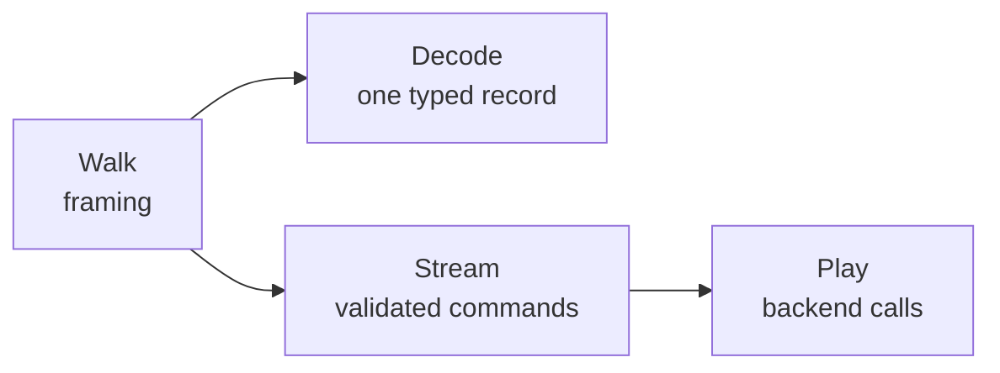

# gowemf

gowemf reads and plays Windows metafiles (WMF, EMF and EMF+) in pure Go. Reach
for it when you need to render vector images embedded in Office or other
documents in your own renderer: `Play` keeps the GDI and GDI+ drawing state and
hands your backend fills, strokes, images and positioned text in destination
coordinates. Anything it cannot draw faithfully is reported, never skipped
silently. It was written for embedded-image rendering in
[spine](https://github.com/mgilbir/spine).

MIT licensed. Requires Go 1.25 or later. The only external Go dependency is
[golittlecms](https://github.com/mgilbir/golittlecms), for color management;
no cgo or native runtime is needed.

## Quick start

```sh
go get github.com/mgilbir/gowemf
```

Implement the three `Backend` methods in your renderer and play the file into
a destination rectangle:

```go
type canvas struct{ /* your renderer */ }

func (c *canvas) FillPath(p gowemf.Path, rule gowemf.FillRule, paint gowemf.Paint, clip gowemf.Clip) error {
	return nil // fill p with paint under rule, inside every region of clip
}
func (c *canvas) StrokePath(p gowemf.Path, s gowemf.Stroke, clip gowemf.Clip) error {
	return nil // stroke p with the effective pen s
}
func (c *canvas) DrawImage(img gowemf.ImageDraw, clip gowemf.Clip) error {
	return nil // composite img.Source of img.Image through img.Transform
}

func render(data []byte) error {
	var reported []gowemf.UnsupportedOperation
	_, err := gowemf.Play(data, gowemf.PlayOptions{
		Destination: gowemf.Box{Width: 800, Height: 600},
		Unsupported: func(u gowemf.UnsupportedOperation) error {
			reported = append(reported, u) // or return an error to stop
			return nil
		},
	}, &canvas{})
	return err
}
```

Add `MeasureText` and `DrawText` (`TextBackend`) to receive text,
`FillGradient` (`GradientBackend`) for gradient meshes, and `DrawRaster`
(`RasterBackend`) for raster operations that read the destination. Without
an `Unsupported` callback, `Play` stops with `ErrUnsupported` at the first
operation it cannot draw. The [rendering guide](docs/guide/rendering.md)
explains each call; `ExamplePlay` in
[example_play_test.go](example_play_test.go) is a runnable version that builds
a one-rectangle EMF in code.

## What it supports

| Format | Decoded | Drawn by `Play` | Not yet |
| --- | --- | --- | --- |
| MS-WMF | Standard and placeable framing; drawing, state and object records; text; DIB and Bitmap16 layouts; embedded-EMF fragments, with explicit checksummed extraction; other escapes as untyped data | All eight mapping modes, objects with lowest-free-slot reuse, regions, palettes, text, DIB transfers | Typed printer escapes; colored Bitmap16 patterns; flood fill and region inversion |
| MS-EMF | Framing and header extensions; geometry, transforms and paths; objects and extended fonts; text; regions, palettes, gradients and raster transfers; logical color spaces | Geometry, paths, world transforms, clipping and metaregions, bitmaps and raster operations, gradients, text | WidenPath; flood fill and InvertRgn; masked MaskBlt/PlgBlt; non-sRGB ICM; pixel-format and OpenGL records; halftone color adjustment |
| MS-EMFPLUS | Drawing and state records, including terminal-server layouts; objects; raw, PNG, JPEG, GIF and TIFF bitmaps; image-effect parameters | Shapes, paths and splines; pens with caps, joins, dashes and compound lines; solid, hatch, texture, linear- and path-gradient brushes; bitmap and metafile images; containers and clipping; driver strings | DrawString; StrokeFillPath; image effects beyond lookup tables and color matrices; some caps, gradients and pens; terminal-server records |

Record-by-record detail is in [decoding](docs/coverage/decoding.md),
[GDI playback](docs/coverage/playback-gdi.md),
[EMF+ playback](docs/coverage/playback-emfplus.md) and
[images and color](docs/coverage/images-and-color.md) coverage. Acceptance by
the framing parser is **not** a claim that a record is valid or drawn.

## Choosing a layer



`Walk` checks framing and yields zero-copy record views; `Decode` types one
record; `Stream` yields validated commands for your own interpreter; `Play`
draws through a backend. See the [architecture](docs/architecture.md) and
the [inspection guide](docs/guide/inspecting.md).

## Documentation

The [documentation index](docs/index.md) routes questions to documents:

- Guides: [rendering with Play](docs/guide/rendering.md),
  [inspecting and streaming records](docs/guide/inspecting.md),
  [images and color](docs/guide/images.md).
- Reference: [limits](docs/reference/limits.md),
  [errors and ownership](docs/reference/errors.md),
  [gowemfdump](docs/reference/gowemfdump.md), and the Go documentation.
- Why playback behaves as it does: [GDI](docs/interpretations/gdi.md),
  [EMF+](docs/interpretations/emfplus.md) and
  [decoding](docs/interpretations/decoding.md) interpretations.
- How it is checked: [testing and oracles](docs/testing/README.md).
- What changed: [CHANGELOG.md](CHANGELOG.md).

## Development

```sh
make check            # format, build, tests, vet, race, 32-bit tests (root module)
make rendercheck-vet  # vet the separate rendercheck module (Go 1.26)
make fuzz             # seven 30-second fuzz targets, two workers each
make bench            # generated-input microbenchmarks with allocation counts
make test-external    # pinned POI corpus, code-page tables and Unicode bidi tests
make test-oracle      # Apache POI record oracle; needs java and javac
make test-render      # LibreOffice render oracle; see docs/testing for prerequisites
make codepages        # regenerate codepage_tables.go from the pinned files
make bidi             # regenerate internal/bidi/tables.go from the pinned UCD files
go run ./cmd/gowemfdump -summary file.emf
```

The `*-download` targets (`corpus-download`, `codepages-download`,
`unicode-download`, `oracle-download`) fetch pinned inputs into the ignored
`.external/` directory. Ordinary tests are offline and build their inputs in
Go. [Testing](docs/testing/README.md) lists what each target proves, what it
needs and when to run it; [AGENTS.md](AGENTS.md) holds the project rules.

## Specifications and sources

The code was written from these specifications; no third-party implementation
code has been ported.

- [MS-WMF](https://learn.microsoft.com/en-us/openspecs/windows_protocols/ms-wmf/),
  [MS-EMF](https://learn.microsoft.com/en-us/openspecs/windows_protocols/ms-emf/)
  (both revision 18.0) and
  [MS-EMFPLUS](https://learn.microsoft.com/en-us/openspecs/windows_protocols/ms-emfplus/)
  (revision 20.0), all published April 23, 2024.
- [MS-UCODEREF](https://learn.microsoft.com/en-us/openspecs/windows_protocols/ms-ucoderef/)
  revision 16.0 and its Windows best-fit code page files, for ANSI text.
- Unicode Standard Annex #9 revision 52 (Unicode 18.0.0), for bidirectional
  text.
- TIFF Revision 6.0 and GIF89a, for EMF+ bitmaps.
- Microsoft's GDI+ reference, where MS-EMFPLUS defers to GDI+ behavior.

Where these leave room, the chosen readings are recorded under
[interpretations](docs/interpretations/gdi.md).

## Licensing and porting policy

- Kaitai WMF (CC0) and unidoc/emf (MIT) are potential port sources, subject to
  verification of the particular revision and retention of required notices.
- Apache POI is an execution-only parse oracle. A source port would require a
  deliberate licensing decision and preservation of Apache license/NOTICE
  obligations.
- LibreOffice, libemf2svg, and Inkscape are behavioral oracles, not port
  sources. Avoid their implementation source when developing this library.
- Verify licenses before using other implementations or corpora.

Third-party notices are in [THIRD_PARTY_NOTICES.md](THIRD_PARTY_NOTICES.md).

## Status and next steps

Remaining work: implement the families listed as not yet supported; connect
`Play` to spine's renderer; add EMF+ DrawString to playback; and re-run the
manual [Windows GDI/GDI+ comparison](docs/testing/windows-oracle.md) after
playback changes. Windows remains the primary playback oracle. LibreOffice
agreement covers the generated scenes in the
[LibreOffice oracle](docs/testing/libreoffice-oracle.md) and diverges from the
specifications in several pinned cases. No pixel-perfect or full-format
rendering claim is made. Fonts and metrics must be controlled for meaningful
cross-renderer text comparisons.
