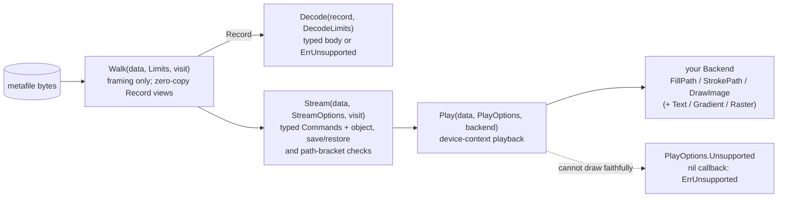
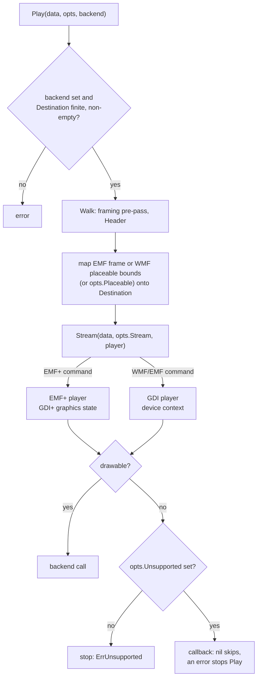
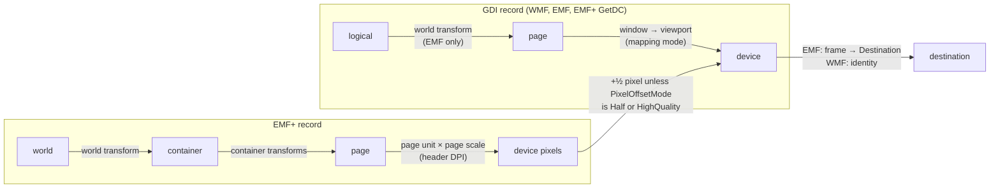
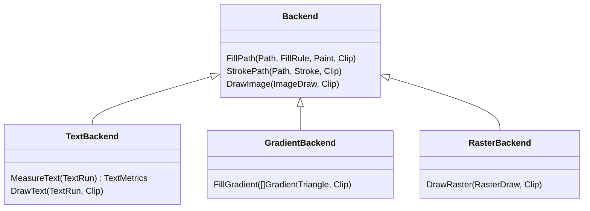

# Architecture

gowemf reads a metafile in layers. Each layer checks more than the one below
and hands the caller something closer to a picture. Reach for this to choose
an entry point, or to see how `Play` drives a backend. All four functions take
the whole file as a byte slice and are bounded by
[limits](reference/limits.md).

| Layer | Use it to | You get | You own |
| --- | --- | --- | --- |
| `Walk` | Validate framing, index records, extract embedded data | `Record` views (format, type, flags, offsets, raw bytes) and a `Header` | Interpreting every record |
| `Decode` | Read one record's fields | A typed body (see [decoding coverage](coverage/decoding.md)) | Object tables, state, drawing |
| `Stream` | Drive your own GDI/GDI+ interpreter | Typed `Command`s in playback order, with WMF object slots allocated, references checked and continued EMF+ objects assembled | Transforms, clipping, styles, text, drawing |
| `Play` | Render through a small backend | Fills, strokes, images and positioned text in destination coordinates | Rasterization, font realization, shaping |

## How Play works

`Play` checks the framing, maps the picture onto `PlayOptions.Destination`,
and then runs `Stream` with its own player as the visitor. The stream
selects the records to play: EMF+ records by default for EMF+ files, plus the
GDI records inside GetDC intervals, or only the GDI fallback of a Dual file
with `PlayOptions.Stream.PreferGDI`.

Backend calls happen as records play, so a later failure can follow
output that was already drawn. When output must be all-or-nothing, run
`Stream(data, opts.Stream, nil)` first (see [errors](reference/errors.md)).

## Coordinate spaces

Every drawing record is mapped to destination coordinates by one affine
matrix, composed from the current state when the record plays. GDI and EMF+
records compose different chains; both end in the same device-to-destination
mapping, fixed when playback starts.

For an EMF, device units are reference-device pixels (szlMillimeters over
szlDevice), and the header frame is scaled onto `PlayOptions.Destination`.
For a WMF the device is the destination itself: the placeable bounds are the
initial window and `Destination` the viewport, so the device-to-destination
step is the identity ([device units](interpretations/gdi.md#device-units-and-the-destination),
[EMF+ coordinate spaces](interpretations/emfplus.md#coordinate-spaces-and-page-units)).

## Backend capabilities

A backend implements `Backend` and may add optional interfaces. `Play`
checks for them per operation; whatever the backend cannot take is reported.

| Interface | Without it |
| --- | --- |
| `TextBackend` | All text is reported |
| `GradientBackend` | EMR_GRADIENTFILL and EMF+ path-gradient fills are reported |
| `RasterBackend` | Bitmap and pattern transfers whose raster operation combines source, pattern and destination are reported, except an exact SRCAND/SRCPAINT sprite pair, which is drawn as one masked image ([ruling](interpretations/gdi.md#srcand-and-srcpaint-sprite-pairs)) |

The [rendering guide](guide/rendering.md) describes what each call receives.

## Repository layout

| Path | Contents |
| --- | --- |
| `*.go` (root) | The `gowemf` package: framing (`metafile.go`, `wmf.go`, `emf.go`, `emfplus.go`), decoding (`decode*.go`, `plus_*.go`), streaming (`stream*.go`), playback (`playback*.go`), images (`dib*.go`, `image.go`, `gif.go`, `tiff*.go`, `effects.go`) and color (`color*.go`) |
| `cmd/gowemfdump` | JSON record dump for diagnostics ([reference](reference/gowemfdump.md)) |
| `internal/bidi`, `internal/codepage` | UAX #9 and code-page table support, with their generators `internal/bidigen` and `internal/codepagegen` |
| `internal/corpus`, `internal/corpusfetch` | Pinned download manifests and the downloader |
| `internal/oracle`, `internal/raster` | Test-only LibreOffice runner and reference rasterizer |
| `rendercheck/` | Separate test-only module for text render oracles (needs Go ≥ 1.26) |
| `tools/` | Java POI adapters and the Windows oracle script |
