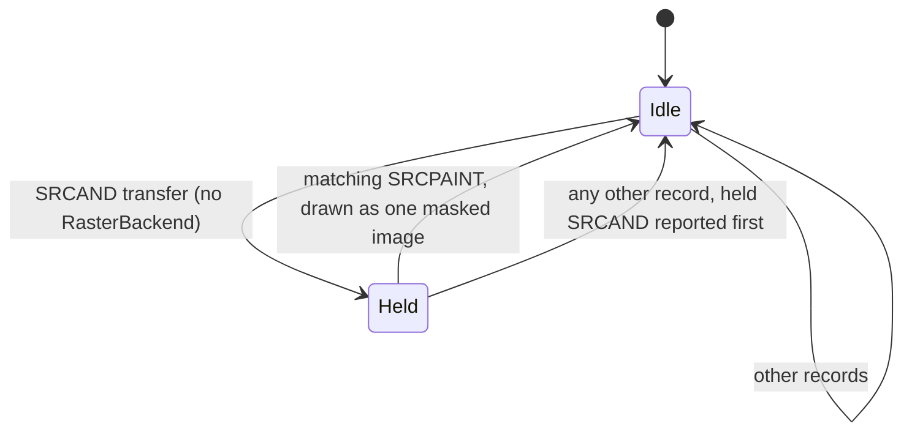

# GDI playback interpretations

How `Play` resolves the places where MS-WMF and MS-EMF leave room, conflict
with each other, or disagree with what Windows draws. Read this when playback
output surprises you or before changing a rule: each section states the
question, the specification text, the choice and where the evidence is. Each
ruling lives only here; other documents link to it. The supported-record
inventory is in [GDI playback coverage](../coverage/playback-gdi.md).

| Ruling | Decision | Windows/oracle evidence |
| --- | --- | --- |
| [Graphics mode and shape construction](#graphics-mode-and-shape-construction) | EMF shapes are built in logical space with edges included, as Windows' EMF playback does; WMF keeps GM_COMPATIBLE rules | [link](../testing/windows-oracle.md#shape-construction) |
| [Pen widths](#pen-widths) | Pen widths are logical; the pen follows the world and page mapping, so anisotropic mappings draw ellipses | [link](../testing/windows-oracle.md#pen-widths) |
| [Deleted and saved selections](#deleted-and-saved-selections) | Deleting a selection selects the stock default; a saved state keeps its object and RestoreDC reselects it | [link](../testing/windows-oracle.md#saved-selections) |
| [The object index equal to Handles](#the-object-index-equal-to-handles) | Play creates nothing at index Handles, as Windows does; Stream accepts it | [link](../testing/windows-oracle.md#object-table-size) |
| [MM_ISOTROPIC extents](#mm_isotropic-extents) | The viewport is re-adjusted on every extent change; zero extents and invalid modes are ignored | — |
| [Device units and the destination](#device-units-and-the-destination) | WMF device units are destination units; EMF device pixels come from szlMillimeters, never szlMicrometers | [link](../testing/windows-oracle.md#szlmicrometers) |
| [Clip region units and bitmap bounds](#clip-region-units-and-bitmap-bounds) | ExtSelectClipRgn regions are logical; bitmap Bounds outside the clip do not suppress drawing | — |
| [Bitmap source origins](#bitmap-source-origins) | StretchDIBits, StretchDIB and SetDIBitsToDevice sources are measured from the bottom row, as Windows does; BitBlt and StretchBlt from the top | [link](../testing/windows-oracle.md#stretchdibits-sources) |
| [Raster operations](#raster-operations) | ROP3 is classified by its truth table; only the six copy/fill operations avoid RasterBackend | — |
| [SRCAND and SRCPAINT sprite pairs](#srcand-and-srcpaint-sprite-pairs) | Without RasterBackend an exact mask/image pair becomes one masked image; anything else is reported | — |
| [PolyDraw and the To records](#polydraw-and-the-to-records) | Continue from the current position, starting a new figure after a closed one | — |
| [Text placement](#text-placement) | EMF text records choose their graphics mode; alignment, TA_UPDATECP, extra and justification follow GDI | — |
| [Bidirectional text](#bidirectional-text) | UAX #9 at paragraph level 0 or 1; Play reorders, the backend shapes and mirrors | [link](../testing/windows-oracle.md#confirmed-interpretations) |
| [Double-byte text](#double-byte-text) | MS-UCODEREF decoding with default characters; one advance per byte | [link](../testing/windows-oracle.md#double-byte-decoding) |
| [Palette entries and palette colors](#palette-entries-and-palette-colors) | PALETTEENTRY order (red, green, blue, flags); PALETTEINDEX/PALETTERGB through the selected palette | [link](../testing/poi-oracle.md#known-poi-discrepancies) |
| [Monochrome pattern brushes](#monochrome-pattern-brushes) | Text color for clear bits, background for set bits; EMR_CREATEMONOBRUSH follows measured GDI behavior | [link](../testing/windows-oracle.md#monochrome-brushes) |
| [Regions and FrameRgn](#regions-and-framergn) | Region data is logical; FrameRgn is computed exactly under a work budget | — |
| [Gradient fills](#gradient-fills) | Rectangles become two exactly linear triangles; TriVertex alpha is ignored | — |
| [Pixel rules](#pixel-rules) | GDI's integer pixel rules beyond edge exclusion are the backend's; Stroke.PixelCenter helps emulate them | — |

## Graphics mode and shape construction

EMF records no graphics mode. A non-identity world transform implies
GM_ADVANCED, because GDI records world transforms only in that mode;
otherwise GM_COMPATIBLE applies. WMF is always GM_COMPATIBLE. MS-EMF 2.1.16
builds GM_COMPATIBLE bounding-rectangle shapes in device space with the
right and bottom edges excluded and the arc direction unreflected, and
GM_ADVANCED shapes in world space with the edges included. Windows' EMF
playback builds every EMF shape the GM_ADVANCED way, so a page mapping
that reflects one axis reverses the displayed arc direction; WMF playback
keeps the GM_COMPATIBLE rules. Play follows Windows ([evidence](../testing/windows-oracle.md#shape-construction)).

## Pen widths

LogPen and geometric extended pen widths are logical units. A pen is a
circle of that width transformed with the world and page mapping, so an
anisotropic mapping draws it as an ellipse in EMF and WMF alike, as
Windows does ([evidence](../testing/windows-oracle.md#pen-widths)); MS-WMF 3.1.4.2's width scaled by the logical
x-axis agrees whenever both axes scale equally. MS-EMF 2.2.19's statement
that non-geometric LogPen widths are device units conflicts with its own
MUST that they be 1, and with the GDI call EMR_CREATEPEN records. A zero
width is a hairline, as are cosmetic extended pens.

## Deleted and saved selections

Deleting a selected object activates the default stock object (MS-EMF
3.1.1.1). The same rule applies to WMF, whose specification releases the
object's resources on deletion. A selection held by a saved state, logical
palettes included, keeps its object when the handle is deleted or reused,
and RestoreDC reselects it, as Windows does ([evidence](../testing/windows-oracle.md#saved-selections)).

## The object index equal to Handles

MS-EMF 3.1.1.1 sizes the object table for Handles+1 entries, index zero
reserved, so `Stream` accepts an object index equal to Handles. Windows
counts index zero among the Handles and fails to create an object there;
Play likewise creates nothing there and lets selections, palette
updates and region fills that use the index do nothing, keeping the
previous selection ([evidence](../testing/windows-oracle.md#object-table-size)).

## MM_ISOTROPIC extents

MM_ISOTROPIC adjusts the stored viewport extent whenever an extent changes,
keeping the smaller physical scale (MS-WMF 2.1.1.16). Switching to a scalable
mode retains the current extents; zero extents and invalid modes are ignored,
as the GDI calls they record would fail. Extents are kept as floating-point
values rather than GDI's integers.

## Device units and the destination

WMF device units are destination units: the placeable bounds are the initial
window and the destination is the viewport (MS-WMF 3.1.3); records may then
replace either. Fixed mapping modes use the resolution those bounds imply.
EMF device units are reference-device pixels mapped onto the destination by
the header frame (or the inclusive bounds when the frame is empty). The
pixel size is szlMillimeters over szlDevice. MS-EMF 2.2.11 does not say
whether szlMicrometers takes precedence; Windows GDI and GDI+ ignore it,
placing a picture by szlMillimeters even where szlMicrometers refines it by
0.3% ([evidence](../testing/windows-oracle.md#szlmicrometers)), and writers also store values in it that are not the
device size.

## Clip region units and bitmap bounds

ExtSelectClipRgn regions are logical units, as MS-EMF 2.3.2.2 specifies. The
"no effect" rule for bitmap records whose Bounds miss the clip is not applied;
the drawing itself is clipped.

## Bitmap source origins

SetDIBitsToDevice sources have a lower-left origin (MS-EMF 2.3.1.5).
MS-EMF 2.3.1.7 gives StretchDIBits sources an upper-left origin, but
Windows measures them from the bottom row of the image, in bottom-up and
top-down DIBs alike; Play follows Windows ([evidence](../testing/windows-oracle.md#stretchdibits-sources)). The WMF StretchDIB
and SetDIBToDev records follow the same rules; StretchBlt, BitBlt and the
WMF DIBBitBlt and DIBStretchBlt keep an upper-left origin. A partial
SetDIBitsToDevice source in a top-down DIB is reported. Source rectangles are
clamped to the bitmap and only existing pixels are drawn. A source
transform (xformSrc) that leaves the source with fractional edges maps it
exactly onto the destination, clipped there as for EMF+ images; GDI's own
integer rounding of such sources is not modeled.

## Raster operations

ROP3 operations are classified by their index byte, the operation's truth
table (MS-WMF 2.1.1.31): bit P<<2|S<<1|D is the result for pattern, source
and destination bits P, S and D. SRCCOPY, NOTSRCCOPY, PATCOPY, BLACKNESS,
WHITENESS and DSTCOPY become ordinary images and fills; every other
operation goes to a `RasterBackend`, applied to each bit of the 8-bit
red, green and blue values. SRCCOPY and the raster operations ignore DIB
alpha. A null brush leaves the destination unchanged for operations that
use the pattern; a hatch brush in TRANSPARENT mode is reported for them,
because its background pixels have no bits to combine.

## SRCAND and SRCPAINT sprite pairs

Without a `RasterBackend`, an SRCAND transfer is held until the next
record. If that is an SRCPAINT transfer with the same source rectangle,
placement and clip, without HALFTONE, of an image that is black wherever
the SRCAND bitmap is white, and that bitmap is only black and white, the
pair is exactly the image with the mask's black pixels opaque and its
white pixels transparent, and is drawn so. Otherwise both are reported, in
record order.

The [sprite pairing](#srcand-and-srcpaint-sprite-pairs) rule holds one
transfer across records:

## PolyDraw and the To records

PolyDraw, PolylineTo and the "To" records continue from the current
position, starting a new figure after a closed one.

## Text placement

Text placement: EMF text records state their own graphics mode, which
selects GM_COMPATIBLE (device space, upright, only the height scaled by the
y-axis and advances by the x-axis) or GM_ADVANCED (world space, full
transform, orientation relative to the escapement); WMF is GM_COMPATIBLE.
The string extent for alignment and TA_UPDATECP is the sum of the advances
used. With TA_UPDATECP the position moves to the string's end in its drawing
direction: forward for TA_LEFT, back for TA_RIGHT, unchanged for TA_CENTER.
Character extra and justification apply only without explicit advances and
are rounded to device pixels under GM_COMPATIBLE; break extra goes to U+0020,
with any remainder one unit at a time to the first breaks. The WMF character
extra is read as signed, as GDI's SetTextCharacterExtra takes it, although
MS-WMF 2.3.5.25 describes the field as unsigned. Symbol-charset bytes map to
U+F000+byte, the private-use range symbol fonts' Windows cmaps use. Charsets
map to code pages as Windows' TranslateCharsetInfo documents.

## Bidirectional text

Text is laid out with the Unicode Bidirectional Algorithm (UAX #9, Unicode
18.0.0, `internal/bidi`), as GDI's language pack does for Unicode text: the
paragraph level is 1 under ETO_RTLREADING or TA_RTLREADING and 0
otherwise, every paragraph separator ends a paragraph, and the string is
one line. Play reorders the elements (L2) into `TextRun.Origins` and passes
the levels; shaping, mirroring (L4) and mark placement (L3) are the
backend's. A right-to-left element is placed against the pen's movement:
its measured advance ends at the right of the advance it is given, so
explicit spacing beyond it falls on its left (MS-EMF 2.2.5 lays such
advances "right to left"). Glyph indexes are already shaped and are only
laid right to left. MS-EMF 2.1.11 and MS-WMF 2.1.2.3 add that right-to-left
reading order SHOULD apply only with a Hebrew or Arabic font; the flag is
honored with every font, because the same definitions say the text MUST be
laid out right to left. Windows GDI places `text-bidi.emf` in the same
order and positions ([evidence](../testing/windows-oracle.md#confirmed-interpretations)).

## Double-byte text

Double-byte ANSI text decodes as MS-UCODEREF 3.1.5.1.1 specifies: a lead
byte with an unmapped trail byte becomes the code page's default
character in place of both bytes; a lead byte at the end, or before a NUL,
becomes it alone. Windows' MultiByteToWideChar decodes every byte, pair and
invalid sequence of the four code pages the same way ([evidence](../testing/windows-oracle.md#double-byte-decoding)).
ANSI records give one advance per byte, so a double-byte character
advances by the sum of its two bytes' advances, which keeps every later
character where the record places it. LibreOffice agrees
(`text-dbcs.wmf`).

## Palette entries and palette colors

Palette entries are read as GDI PALETTEENTRY values (red, green, blue,
flags), as MS-WMF 2.2.2.13 specifies. MS-EMF 2.2.18 draws LogPaletteEntry as
reserved, blue, green, red, which is that structure read as a most-
significant-first DWORD; Apache POI follows the drawing (see [POI discrepancies](../testing/poi-oracle.md#known-poi-discrepancies)).
Palette updates modify the palette object in place, so every selection of it
sees them. AnimatePalette changes only PC_RESERVED entries. COLORREF's
reserved byte must be zero (MS-WMF 2.2.2.8); GDI's PALETTEINDEX (0x01) and
PALETTERGB (0x02) forms are resolved through the selected logical palette and
as plain RGB on a true-color device. Palette entry allocations share the
playback pixel budget.

## Monochrome pattern brushes

Monochrome pattern brushes draw clear bits in the text color and set bits in
the background color, as GDI's CreatePatternBrush documents. For
EMR_CREATEMONOBRUSH, MS-EMF does not say how Usage and the color table
apply; Play follows GDI ([evidence](../testing/windows-oracle.md#monochrome-brushes)): DIB_PAL_INDICES bits are used as
they are, DIB_RGB_COLORS bits are inverted unless the second table color
has the larger channel sum, DIB_PAL_COLORS paints only the text color, and
no brush is created from a top-down DIB, so selecting its handle keeps the
previous brush.

## Regions and FrameRgn

Region data is in logical units, as for ExtSelectClipRgn; WMF scans are
logical (MS-WMF 2.2.2.21). FrameRgn draws R minus R eroded by the brush box,
computed exactly as R intersected with R's complement dilated by that box;
the band sweep is charged to a 16,000,000-step budget per Play call.

## Gradient fills

Rectangle gradients become two triangles whose shading is exactly linear
along the gradient axis; triangle gradients interpolate in destination
space. TriVertex alpha is ignored (MS-EMF 2.2.26). Colors keep 16 bits.

## Pixel rules

GDI's integer pixel rules beyond edge exclusion belong to the backend.
`Stroke.PixelCenter` gives half a device pixel in destination units for
backends that center lines on device pixels, as GDI does.
