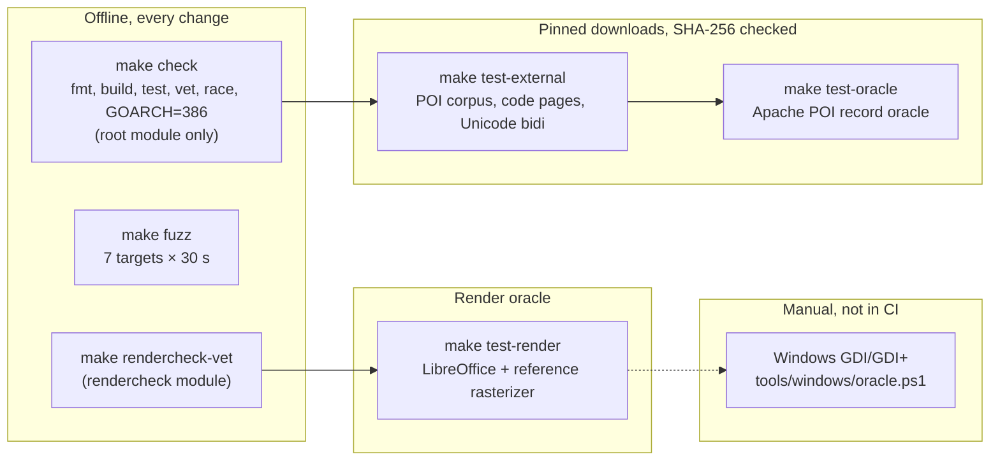

# Testing and oracles

How gowemf is checked, which `make` target proves what, and what each one
needs. Reach for this before running or changing tests, or to judge how much a
passing check actually says. Passing every tier does not establish full
specification conformance or render equivalence with Windows.

## Which target, when

| Target | Proves | Needs | Run it for |
| --- | --- | --- | --- |
| `make check` | Formatting, build, unit and generated-input tests, `go vet`, the race detector and 32-bit (`GOARCH=386`) tests of the root module; offline scene probes | Go ≥ 1.25 | Every code change |
| `make rendercheck-vet` | The separate `rendercheck` module still compiles and vets against the current API | Go ≥ 1.26 | Changes to exported types or playback, which `make check` does not cover |
| `make fuzz` | Seven fuzz targets (framing, typed records/objects, DIBs, streams, playback, TIFF, ICC transforms), 30 s and two workers each | Go | Parser changes |
| `make test-external` | Pinned POI corpus framing, typed decoding, stream validation and playback omissions; generated code-page tables against the best-fit files; the bidi tables and the Unicode conformance tests | Network on first run | Framing, corpus, code-page or bidi changes |
| `make test-oracle` | Record agreement with Apache POI 5.4.1 ([POI oracle](poi-oracle.md)) | Network, `java`, `javac` | Decoder changes |
| `make test-render` | Pixel agreement with LibreOffice and pinned divergences ([LibreOffice oracle](libreoffice-oracle.md)) | See [prerequisites](#prerequisites) | Playback changes |
| Windows run | Agreement with GDI and GDI+ ([Windows oracle](windows-oracle.md)) | A Windows machine | Changes to a Windows-measured ruling |

CI runs `make check` and `make fuzz` on Go 1.25 and stable; `make
test-external` and `make test-oracle` together; and `make rendercheck-vet` and
`make test-render` on ubuntu-24.04 (`.github/workflows/ci.yml`).

## Prerequisites

`make test-render` needs:

- LibreOffice. The divergence probes are pinned to LibreOffice 24.2.7.2, the
  ubuntu-24.04 `libreoffice-draw` package; other versions can fail them,
  which means the pinned divergence needs review.
- Liberation Sans (`fonts-liberation2`) found by fontconfig's `fc-match`.
- `prlimit` (util-linux), which bounds each LibreOffice process.
- A JDK with `java` and `javac` (CI uses Temurin 21) for the POI bitmap
  renderer.
- Go ≥ 1.26 for the `rendercheck` text tests.

Missing tools fail the test instead of skipping it.

## Environment variables

The `make` targets set these; set them yourself only to run one test directly.

| Variable | Enables |
| --- | --- |
| `GOWEMF_EXTERNAL=1` | `TestExternalCorpus`, `TestCodePageTables`, `TestDBCSTables`, and the bidi `TestTables`, `TestBidiTest`, `TestBidiCharacterTest` |
| `GOWEMF_ORACLE=1` | `TestPOIOracle` |
| `GOWEMF_RENDER=1` | `TestLibreOfficeRenderOracle`, `rendercheck`'s `TestLibreOfficeText` |
| `GOWEMF_WINDOWS_INPUTS=<dir>` | `TestWriteWindowsInputs` in both modules |
| `GOWEMF_WINDOWS_OUT=<dir>` | `TestCompareWindowsOutputs`, `TestCompareWindowsDecoding`, `rendercheck`'s `TestCompareWindowsText` |

## Inputs and artifacts

Ordinary tests are offline and build their inputs in Go; no external binary
fixtures are tracked. Downloads use only the Go standard library, fixed
upstream revisions, exact byte lengths and SHA-256 digests, bounded reads,
timeouts, and verified temporary files; a corrupt cached file is refused, and
missing or corrupt inputs fail rather than skip. Rate-limited requests (HTTP
429 or 503) are retried up to four attempts in all, honoring `Retry-After` up
to 30 seconds and otherwise backing off from one second with jitter, because
CI starts many jobs against the same hosts at once. Everything downloaded or
rendered lives under the ignored `.external/` directory, and CI keeps render
artifacts for seven days. Manifests: `internal/corpus/manifest.go` (POI
corpus), `oracle.go` (POI jars), `codepages.go` and `unicode.go`. Upstream
repository licensing does not establish redistribution rights for every
embedded document: downloaded inputs must remain uncommitted and unshipped.

## Pinned corpus

`make test-external` checks six Apache POI files (WMF, EMF, EMF+ and an
embedded WMF object) at a pinned POI commit: framing and record counts, typed
decoding, native stream validation and playback. With a text backend and a
stated DEFAULT_CHARSET, the GDI records of the pinned corpus play without
reported omissions, including the monochrome DIB_PAL_INDICES brushes of
`nested_wmf.emf`; `make test-external` asserts this. EMF+ playback of
`nested_wmf.emf` reports 52 omissions: its embedded WMF creates BS_PATTERN
brushes with META_DIBCREATEPATTERNBRUSH records whose Target is a DIB. MS-WMF
2.3.4.8 defines Target as a DIB Object, but its brush table says a BS_PATTERN
brush contains a Bitmap16, which playback follows. The test pins that report
until the conflict is settled.

## What the offline tests cover

Generated tests cover signed coordinates, variable offsets/counts, text
padding, object reuse, path/save-state errors, stream selection, continuation
padding, region/gradient bounds, bitmap orientation, masks, palettes, RLE,
alpha and image budgets. Generated color tests include analytic linear-RGB to
sRGB expectations, alpha preservation and concurrent backend calls; gray and
CMYK ICC profiles are generated through public golittlecms APIs (a small
analytical test device, not a printer characterization), and soft-proof tests
use an sRGB identity target and check alpha preservation. TIFF tests cover both byte orders,
planes, orientations, palette/channel precision, exact decompression sizes and
checked arithmetic. Playback unit tests
and offline scene probes check spec-derived geometry and pixels in `make
check`. The [regression log](regression-log.md) records the planted defects
each test was seen to catch.
